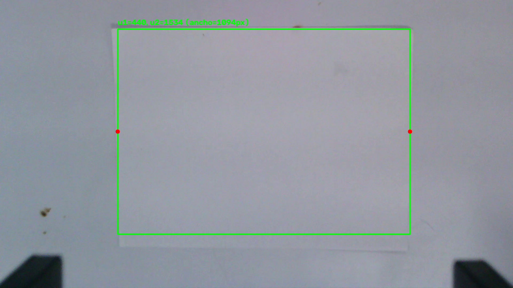
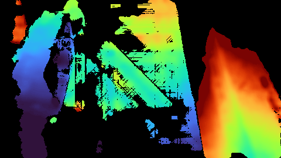
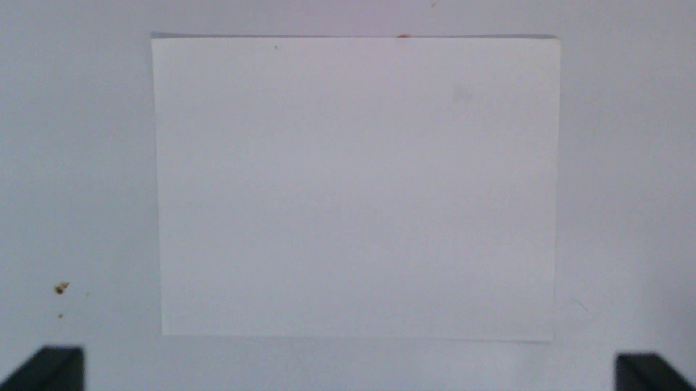
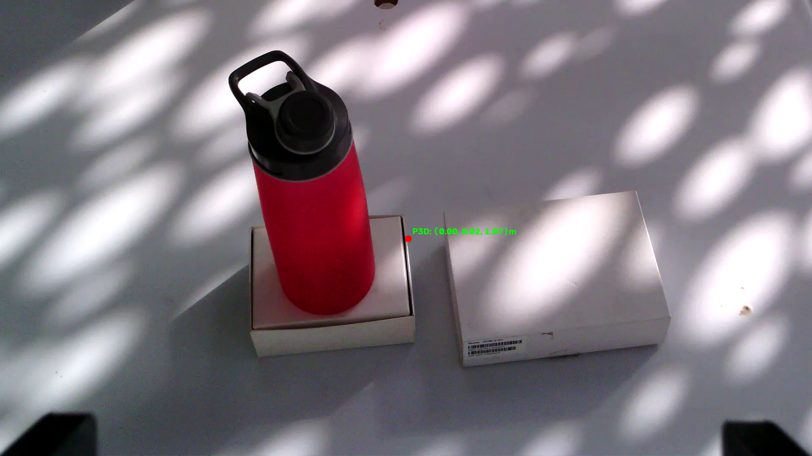
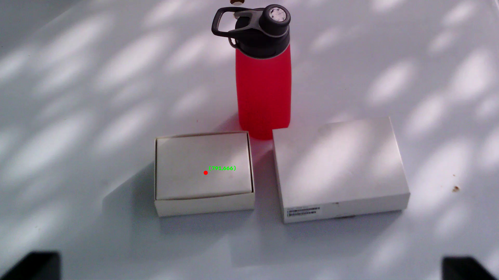
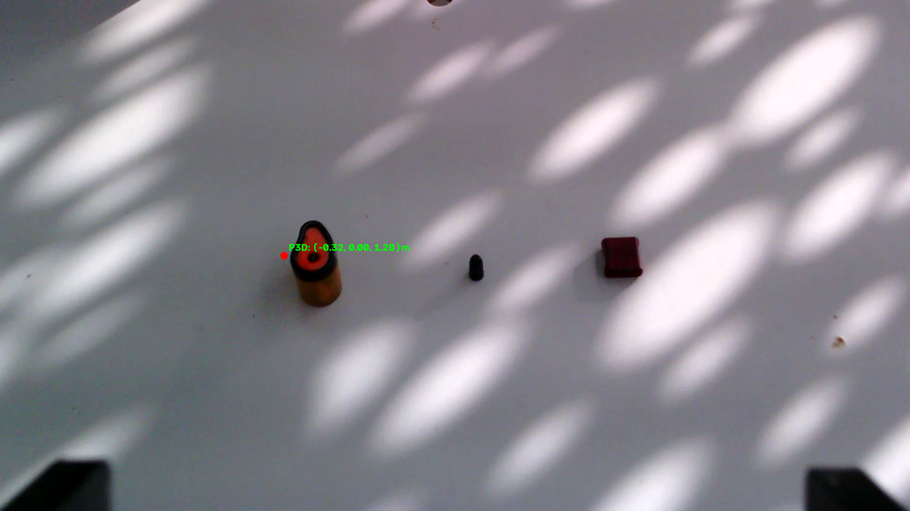
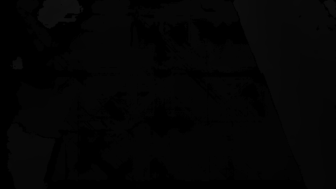
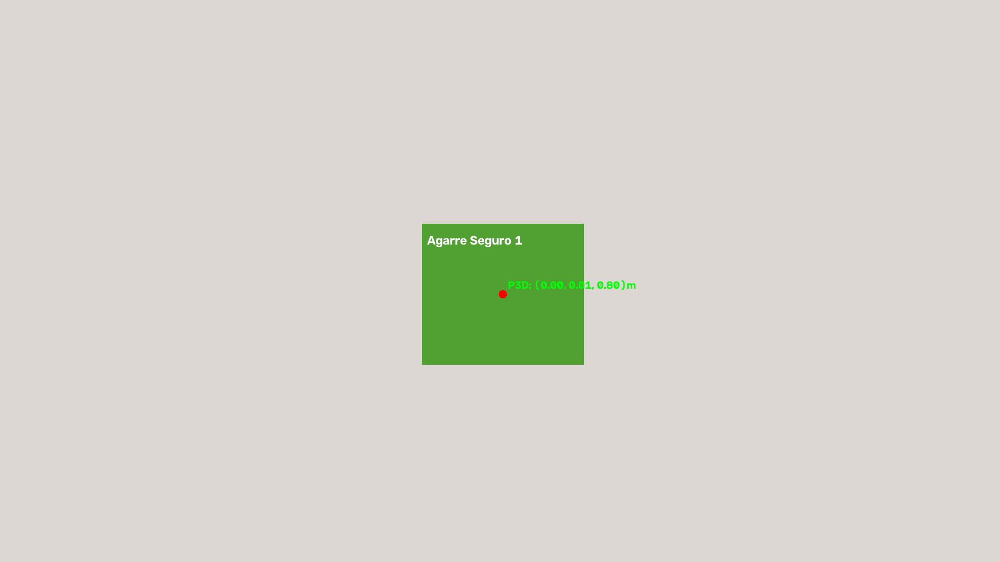
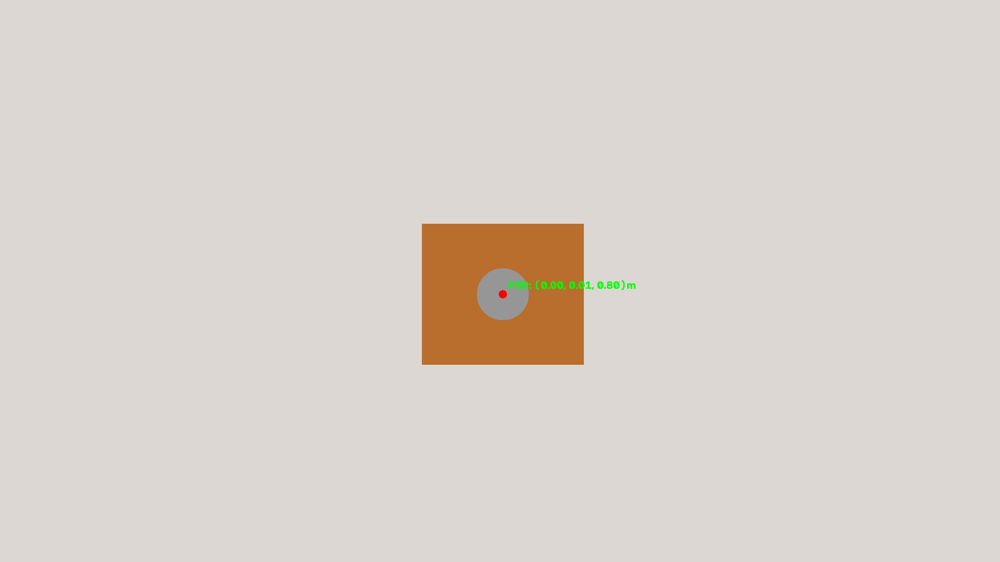
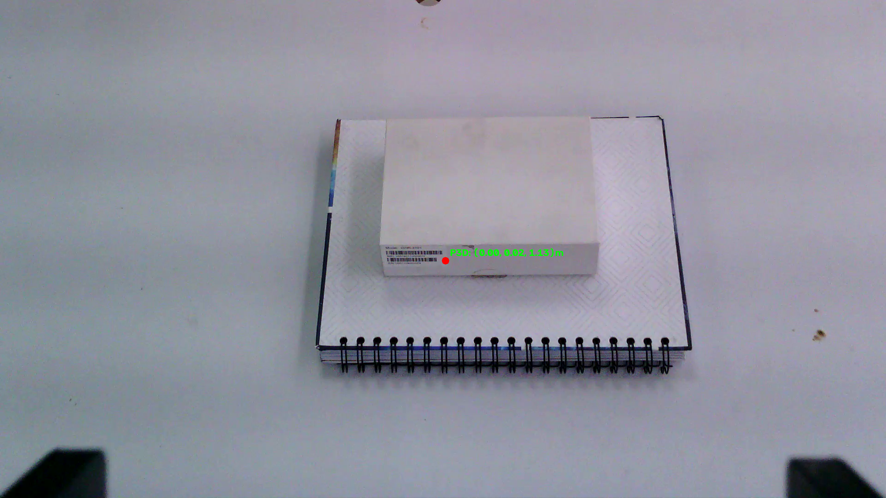

# Laboratorio IA 01B: Pruebas Gemini-Robotics (Embodied AI)
**Razonamiento Espacial, Localización 3D y Agarre con Gemini Robotics-ER 2 y Kinova Gen3**  
*Universidad Militar Nueva Granada — Ingeniería Mecatrónica — Inteligencia Artificial (18314)*

---

## 🎯 ¿Qué pretende esta guía? (Propósito y Alcance)

El objetivo central de la guía es **cerrar la brecha entre los modelos de lenguaje-visión (VLM) y el mundo físico real** mediante un pipeline completo y evaluable de **Inteligencia Artificial Corporizada (Embodied AI)**.

No se trata únicamente de hacer consultas a una API, sino de implementar y validar experimentalmente la cadena completa que va **desde una instrucción en lenguaje natural hasta una acción geométrica y segura que un robot manipulador (Kinova Gen3) pueda ejecutar**:

```
[Lenguaje Natural + Captura RGB-D]
                │
                ▼
  [VLM: Gemini Robotics-ER 2] ────────► Razonamiento Semántico / Espacial / Affordances
                │
                ▼ (Coordenadas normalizadas [y, x] 0-1000)
  [Representación Geométrica] ────────► Conversión a píxeles (u, v)
                │
                ▼
  [Registro Multimodal] ──────────────► Alineación Color (OV5640) + Profundidad (RealSense D410)
                │
                ▼
  [Desproyección Pinhole 3D] ─────────► Coordenadas métricas reales (X, Y, Z) en metros
                │
                ▼
  [Filtro y Espacio de Trabajo] ──────► Validación en prisma de trabajo + Normal de mesa
                │
                ▼
  [Pose de Pre-agarre Segura] ────────► p_pre = p + d_a · n  (Objetivo para MoveIt 2)
```

---

## 📐 Ejes Fundamentales de la Práctica

### 1. Representación Estructurada y Geometría 3D (SO1 - RAE 1.2)
* **Grounding Físico**: Convertir la salida textual/JSON del modelo (puntos normalizados `[y, x]` de 0 a 1000) a coordenadas métricas $(X, Y, Z)$ en metros referenciadas al marco óptico de la cámara.
* **Fusión de Sensores (Cámara de Muñeca Kinova Gen3)**:
  * Sensor de color: Omnivision OV5640 ($1920 \times 1080$, RGB).
  * Sensor de profundidad: Intel RealSense D410 ($480 \times 270$, milímetros).
  * Registro extrínseco/intrínseco entre ambos sensores y estimación de profundidad robusta (mediana local para evitar ceros y ruido).
* **Espacio de Trabajo y Pre-Agarre**:
  * Delimitación de un volumen de trabajo (prisma 3D) en el que los objetos son válidos.
  * Cálculo de la normal $\vec{n}$ del plano de la mesa a partir de puntos conocidos.
  * Generación de la pose de aproximación/pre-agarre ($p_{pre} = p + d_a \cdot \vec{n}$) y validación de planes de acción.

### 2. Diseño Experimental Riguroso (SO6 - RAE 6.1)
* **Partición Desarrollo / Prueba (D / P)**: Evaluar la generalización del prompt engineering evitando el sobreajuste. Las escenas de Desarrollo ($D$) sirven para iterar los prompts, mientras que las de Prueba ($P$) se evalúan sólo una vez congelado el prompt.
* **Verdad de Terreno Pre-registrada (`verdad_terreno.csv`)**: Establecer cajas delimitadoras y distancias reales con instrumentos físicos antes de ejecutar las consultas al modelo, asegurando objetividad.
* **Ablaciones Controladas**: Aislar factores críticos (por ejemplo, comparar distancias con y sin registro de profundidad reutilizando la misma respuesta de Gemini para no sesgar la medición).

### 3. Cuantificación y Métricas de Desempeño (SO6 - RAE 6.2)
* Medición reproducible y estadística de:
  * **Accuracy, Precision, Recall y F1-Score**: Detección semántica y rechazo de agarres inseguros (donde la clase positiva es la abstención por seguridad).
  * **IoU (Intersection over Union)** y dispersión ($\sigma$ de coordenadas): Estabilidad y exactitud de cajas delimitadoras.
  * **RMSE y MAE**: Error de localización tridimensional métrico.
  * **Latencia y Consumo de Tokens**: Costo computacional según el nivel de razonamiento (`thinking_level`: low vs high) y su viabilidad para arquitectura robótica (por qué un VLM no puede entrar en un lazo de control de 1 kHz).

---

## 🧭 Estructura de Fases del Laboratorio

| Fase | Descripción | RAE Evaluado |
| :--- | :--- | :--- |
| **Fase 0** | Configuración de entorno, clave de API de Gemini (`GEMINI_API_KEY`) y prueba de humo con `pytest`. | Pre-requisito |
| **Fase 1** | Diseño de matriz de pruebas, hipótesis y pre-registro de verdad de terreno (`verdad_terreno.csv`). | RAE 6.1 |
| **Fase 2** | Adquisición de imágenes RGB-D en el robot (Ruta A: RTSP / Ruta B: ROS 2 Jazzy). | Preparación |
| **Fase 3** | Calibración de cámara de color (semejanza de triángulos) y verificación geométrica ($\le 5\%$). | RAE 1.2 |
| **Fase 4** | Implementación de funciones clave en código (`TODO 1` a `TODO 4/5`) y validación con tests. | RAE 1.2 |
| **Fase 5** | **Exp. 1**: Razonamiento semántico con partición Desarrollo ($D$) vs. Prueba ($P$). | RAE 6.1, 6.2 |
| **Fase 6** | **Exp. 2**: Cajas delimitadoras, cálculo de IoU e incertidumbre entre repeticiones. | RAE 6.2 |
| **Fase 7** | **Exp. 3**: Exactitud métrica 3D y ablación controlada del registro de profundidad. | RAE 6.1, 6.2 |
| **Fase 8** | **Exp. 4**: Evaluación de costo vs. beneficio del razonamiento (`thinking_level`: low vs high). | RAE 6.2 |
| **Fase 9** | **Exp. 5**: Espacio de trabajo, detección de agarre seguro e inseguro, y ciclo corporizado. | RAE 1.2, 6.2 |
| **Fase 10**| Script reproducible de análisis (`analisis_lab_ia_01b.py`) y contraste de hipótesis. | RAE 6.2 |

---

## 🚀 Modos de Ejecución: Ruta A (Sin ROS 2) y Ruta B (Con ROS 2)

El proyecto cuenta con compatibilidad completa para ambas arquitecturas de forma simultánea:

### 🔹 Ruta A: CLI Standalone sin ROS 2 (`embodied_sin_ros.py`)
Diseñada para desarrollo rápido, captura directa RTSP, pruebas fuera del robot o estaciones de trabajo sin infraestructura ROS:
```bash
# Captura de escena
python embodied_sin_ros.py capturar --escena semantica1 --nota "D: dos cajas, termo sobre una"

# Consulta de razonamiento con Gemini
python embodied_sin_ros.py consultar --escena semantica1 --tarea propio --grupo G03 --objeto "caja libre"
```

### 🔹 Ruta B: Nodo ROS 2 Jazzy (`embodied_ros2_nodo.py`)
Diseñada para integración robótica completa en Ubuntu 24.04 con ROS 2 Jazzy:
* **Suscripciones**: `/camera/color/image_raw` (`sensor_msgs/Image`), `/camera/depth/image_raw` (`sensor_msgs/Image`), `/embodied/consulta` (`std_msgs/String`).
* **Concurrencia Multi-hilo**: La llamada a Gemini se despacha en un hilo worker (`_cb_consulta` -> `_trabajar`) para no bloquear el executor de ROS 2 ni perder paquetes del stream de video.
* **Publicación (TODO 5)**: Emite `geometry_msgs/PointStamped` en `/embodied/punto_3d` y difunde transformadas métricas en TF2 (`tf2_ros.TransformBroadcaster`) hacia `objetivo_gemini_<i>`.
```bash
# Lanzar el nodo en ROS 2 Jazzy:
python3 embodied_ros2_nodo.py --ros-args -p grupo:=G03 -p thinking:=low

# Enviar una consulta desde otra terminal:
ros2 topic pub --once /embodied/consulta std_msgs/msg/String \
  "{data: '{\"tarea\": \"propio\", \"escena\": \"semantica1\", \"objeto\": \"la caja de hamburguesa libre\"}'}"
```

---

## 📸 Evidencia Experimental y Resultados Visuales

### 1. Calibración Intrínseca y Registro Multimodal (RGB + Profundidad)
Calibración geométrica por semejanza de triángulos sobre la cámara de muñeca Kinova Gen3 acoplada al sensor Intel RealSense D410 ($f_x = 1362.90\text{ px}$, discrepancia de $1.19\%$):

| Captura RGB de Referencia | Mapa de Profundidad Infrarrojo | Grounding y Bounding Box |
| :---: | :---: | :---: |
|  |  |  |
| *Patrón métrico de calibración* | *Profundidad D410 (GRAY16)* | *Detección y escala de píxeles* |

---

### 2. Razonamiento Semántico y Generalización (Exp. 1: D vs P)
Evaluación de la brecha de sobreajuste de prompt ($41.9\%$). El modelo infiere el punto de agarre sobre el objeto meta («caja libre») y se adapta a la perturbación espacial de las entidades:

| Escena de Desarrollo ($D$) | Escena de Prueba Perturbada ($P$) |
| :---: | :---: |
|  |  |
| *Inferencia sobre configuración base ($x = 686$)* | *Reacción inmediata ante reubicación espacial ($x = 411$)* |

---

### 3. Estimación Métrica 3D y Desproyección Estenopeica (Exp. 3)
Localización en coordenadas euclidianas tridimensionales $(X, Y, Z)$ combinando visión computacional y filtrado espacial de mediana ($5 \times 5$):

| RGB con Anotación Tridimensional | Nube / Mapa de Profundidad Registrado |
| :---: | :---: |
|  |  |
| *Cálculo de centroide y error de localización* | *Validación de umbral de píxeles (> 65.5%)* |

---

### 4. Seguridad Operacional y Agarre (Exp. 5: Seguro vs Inseguro)
Validación de la política de abstención de agarre ($100\%$ de recall en seguridad). El sistema inhibe la síntesis de poses cuando detecta interferencia humana o inestabilidad física:

| Agarre Seguro (Objeto Despejado) | Agarre Inseguro (Interferencia Humana) |
| :---: | :---: |
|  |  |
| *Autorizado: Espacio de trabajo libre y estable* | *Rechazado: Detección de mano humana / obstáculo* |

---

### 5. Inferencia Multimodal en Escena de Manipulación
| Detección y Segmentación de Objeto Manipulable |
| :---: |
|  |
| *Grounding semántico y desproyección de pose de aproximación pre-agarre* |

---

## 🔒 Reglas Críticas de Seguridad y Ética

1. **El Robot no se mueve**: El Kinova Gen3 permanece en pose de observación fija. Todo el código de laboratorio es pasivo (lectura de visión y razonamiento).
2. **Privacidad de Imágenes**: Las fotos se envían a la API en la nube; no deben capturarse rostros, identificaciones ni rasgos personales.
3. **Gestión de Claves**: La `GEMINI_API_KEY` debe mantenerse estrictamente como variable de entorno local y jamás subirse a repositorios públicos.
4. **Validación Determinista**: Ningún comando o punto inferido por el VLM puede pasar a un actuador sin pasar previamente por filtros de validación geométrica (volumen de trabajo y física de pre-agarre).

